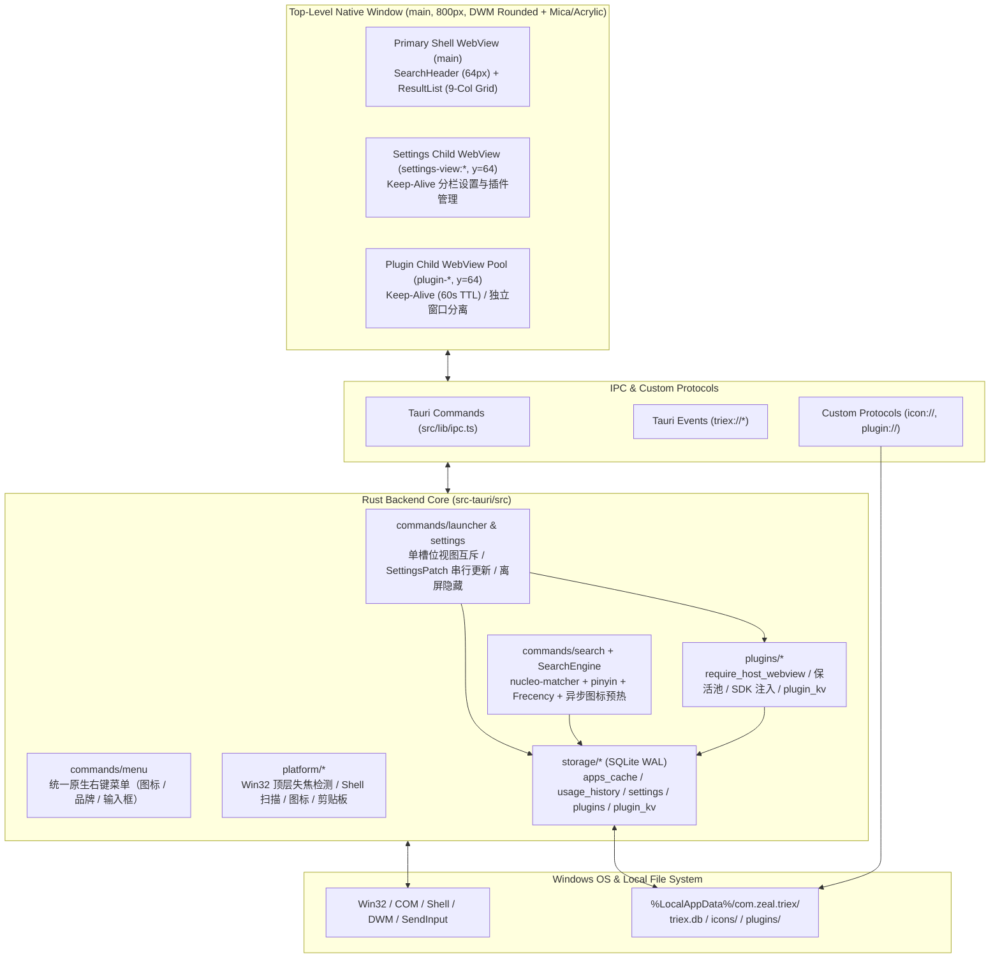
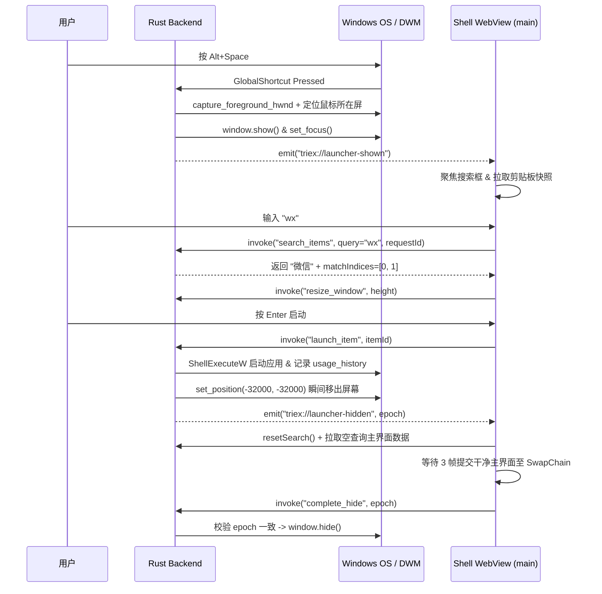

# Triex 系统架构文档

> 本文档描述 **Triex**（基于 Tauri v2 + Rust + React 的 Windows 应用启动器与插件平台）的整体架构、核心子系统设计、关键数据流、IPC 契约与安全边界。  
> 关于各项技术选型背后的权衡理由，请参阅 [架构与实现取舍记录 (ADR)](./architecture-decisions.md)。

---

## 1. 概述与设计目标

**Triex** 是一款面向 Windows 10/11 的轻量级、键盘优先桌面应用启动器与插件宿主：

* **极致轻量与低延迟**：后端采用纯 Rust 实现内存模糊检索与 Windows 原生集成，无 Node.js 常驻进程；冷启动直接加载 SQLite 缓存立即可搜，图标缓存提取与索引发布异步解耦。
* **ZTools 风格主界面与多 WebView 宿主**：`800px` 宽无边框原生圆角纯容器窗体（Windows 11 DWM + Mica/Acrylic），由顶栏/搜索主壳 WebView（`main`）与下方物理零重叠的保活子 WebView（`settings-view:*` 或 `plugin-*`）组成。
* **统一毛玻璃设计系统**：主壳与设置子 WebView 共享 `shadcn/ui` 语义 Token、半透明表面层级（`--surface*`）与悬浮细滚动条；全应用统一使用 Tauri v2 原生上下文菜单并全局屏蔽浏览器默认菜单。
* **严格宿主/插件权限边界**：通过 `require_host_webview` 与 `require_permission` 双层守卫隔离宿主特权命令与第三方插件沙箱命令。

---

## 2. 总体分层架构



---

## 3. 代码目录与职责映射

```text
triex/
├── docs/                                # 架构与设计文档
│   ├── architecture.md                  # 本文档：整体系统架构
│   └── architecture-decisions.md        # 关键技术取舍记录 (ADR)
├── examples/plugins/quick-notes/        # 官方示例插件（随手便签）
├── index.html                           # 主启动器壳 WebView 入口
├── settings.html                        # 设置子 WebView 独立入口
├── src/                                 # 前端 React 应用（Vite 双入口）
│   ├── main.tsx / App.tsx               # 主启动器壳装配
│   ├── settings-main.tsx / SettingsApp.tsx # 设置子 WebView 装配与分栏导航
│   ├── index.css                        # Tailwind v4、毛玻璃表面 Token 与防漂移规则
│   ├── components/
│   │   ├── ui/                          # 精简保留的 shadcn/ui 基础组件
│   │   ├── launcher/                    # 主壳组件（SearchHeader / ResultList / ResultItem / HighlightText）
│   │   └── settings/                    # 模块化设置页（General / Appearance / Index / PluginManager / Command / SettingsPrimitives）
│   ├── hooks/
│   │   ├── useSearch.ts                 # 防竞态 (requestId) + 16ms 微防抖搜索
│   │   ├── useWindowAutoResize.ts       # 搜索态 rAF 高度测量与同步
│   │   ├── useLauncherShortcuts.ts      # Esc 分层退出、Ctrl+M、Ctrl+K、Alt+Enter
│   │   ├── useLauncherEvents.ts         # 窗口显隐握手、子视图状态与全局提示监听
│   │   ├── useNativeContextMenu.ts      # 全局屏蔽浏览器默认菜单并接管输入框原生右键菜单
│   │   └── useThemeSync.ts              # 系统深浅色与配置主题联动
│   ├── stores/
│   │   ├── useLauncherStore.ts          # 主壳专属状态（与设置子 WebView 解耦）
│   │   └── useSettingsStore.ts          # 设置子 WebView 专属状态与串行保存队列
│   └── lib/
│       ├── ipc.ts                       # 强类型 Tauri IPC 封装层
│       ├── protocol.ts                  # http://icon.localhost/{key}.png 地址构造
│       └── utils.ts                     # cn() 样式合并工具
└── src-tauri/                           # Rust 后端 (triex_lib)
    ├── tauri.conf.json                  # 应用元数据与打包配置（纯动态建窗）
    ├── capabilities/
    │   ├── default.json                 # 主壳与设置子 WebView 宿主权限
    │   └── plugins.json                 # 第三方插件 WebView 受限 IPC 通道
    ├── resources/
    │   └── plugin-bridge.js             # 注入插件 WebView 的 window.triex SDK
    └── src/
        ├── lib.rs                       # 纯父窗口初始化、协议注册与顶层窗口事件监听
        ├── state.rs                     # 统一 ContentMode 状态机与线程安全 AppState
        ├── config.rs                    # AppSettings、SettingsPatch 与本地数据路径
        ├── error.rs                     # 统一 AppError (thiserror)
        ├── tray.rs                      # 系统托盘菜单与左键切换
        ├── commands/                    # Tauri IPC Commands 与业务协调 (launcher / menu / search / settings / plugin / clipboard)
        ├── search/                      # 内存搜索引擎 (nucleo-matcher / pinyin_index / matcher / frecency)
        ├── platform/                    # Windows 原生封装 (scanner / icon / launch / window / clipboard / input)
        ├── plugins/                     # 插件宿主与保活池 (manifest / manager / permission)
        ├── protocol/                    # 自定义协议 (icon:// 与 plugin://)
        └── storage/                     # SQLite WAL 持久化与迁移脚本 (001_init.sql)
```

---

## 4. 核心子系统设计

### 4.1 搜索引擎与非阻塞索引协调（`search/` + `index_coordinator.rs`）

1. **拼音与首字母预计算（`pinyin_index.rs`）**：构建期预生成全拼与首字母投影及字符映射表，命中拼音时直接反查原中文字符下标供前端高亮。
2. **多通道加权与 Frecency（`matcher.rs` / `frecency.rs`）**：复用单 `Matcher` 缓冲，按 `name > pinyin_abbr > pinyin_full > keywords` 加权叠加 7 天半衰期 Frecency。
3. **重扫合并与异步图标预热（`index_coordinator.rs`）**：通过 `index_requested` 代数合并并发重扫请求，扫描完成后立即原子替换内存索引并通知前端可搜，随后在后台线程调用 `warm_missing_icons` 异步补齐缺失的 PNG 图标缓存。

### 4.2 物理零重叠多 WebView 与保活池（`window_coordinator.rs` + `plugins/manager.rs`）

* **纯容器窗口 + 上下分区**：`main` 顶层窗口由 `WindowBuilder` 创建。搜索态下主壳 WebView `main` 占满窗口 `800 × h`；进入设置或插件态时，主壳 WebView 收缩至仅占顶栏 `800 × 64`，子 WebView 挂载于 `y = 64` 下方，两个 WebView2 HWND **物理零重叠**。
* **单槽位互斥（`ContentMode`）**：`AppState.content_mode` 统一维护 `Search | Settings | Plugin(session)`，打开设置自动隐藏插件，打开插件自动隐藏设置。
* **保活复用与空闲回收**：
  * 设置子 WebView（`settings-view:*`）首次按需创建，退出时仅 `hide()` 保活，二次打开 `< 5ms`；主窗口隐藏再唤起时完整保留之前的设置页状态。
  * 插件子 WebView（`plugin-<id>:<seq>`）退出时 `hide()` 保活 60 秒，期间重开零延迟复用并派发 `triex:plugin-enter`；超时、禁用或分离为独立窗口时自动 `close()` 释放内存。
* **Win32 顶层窗口级失焦检测**：通过 `GetForegroundWindow()` + `GetAncestor(..., GA_ROOT)` 配合 `35ms` 防抖，确保焦点在顶栏与子 WebView 间切换绝不误隐藏，切出 Triex 外部时准确隐藏。

### 4.3 本地数据存储（`src-tauri/src/storage/`）

所有持久化数据收敛在本地数据目录 `triex.db`（SQLite WAL 模式，`busy_timeout = 5000ms`）：

| 表名 | 主键 | 用途 |
| :--- | :--- | :--- |
| `apps_cache` | `id` | 缓存扫描得到的应用/UWP/系统指令元数据，用于冷启动瞬间恢复搜索索引 |
| `usage_history` | `item_id` | 记录启动次数 (`launch_count`) 与最近时间戳 (`last_used_at`) 驱动 Frecency |
| `settings` | `key` | 持久化 `AppSettings` JSON（快捷键、主题、材质、自定义目录、屏蔽与置顶列表） |
| `plugins` | `id` | 已安装插件元数据、启用状态与完整 `manifest_json` |
| `plugin_kv` | `(plugin_id, key)` | 按 `plugin_id` 隔离的插件 KV 存储（含版本号 `rev` 与更新时间） |

---

## 5. 关键链路时序

### 5.1 呼出 → 搜索 → 启动 → 离屏预重置隐藏



---

## 6. 前后端 IPC 契约总览

### 6.1 Tauri Commands（前端 → Rust）

| 分组 | Command | 调用方权限 | 说明 |
| :--- | :--- | :--- | :--- |
| **搜索与索引** | `search_items(query, requestId, limit?)` | 仅宿主 (`main` / `settings-view:*`) | 执行 `nucleo-matcher` + `pinyin` 搜索并返回高亮下标 |
| | `rebuild_index()` | 仅宿主 | 触发全量异步应用/UWP/插件重扫与后台图标预热 |
| **启动与窗口** | `launch_item(itemId, asAdmin?)` | 仅宿主 | 启动应用/系统指令，或挂载插件/打开设置子视图 |
| | `open_item_folder(itemId)` | 仅宿主 | 在资源管理器中定位目标文件 |
| | `toggle_pin_item(itemId)` / `remove_recent_item(itemId)` | 仅宿主 | 固定/取消固定常用项；清除单条使用记录 |
| | `show_item_context_menu` / `show_brand_context_menu` | 仅宿主 | 弹出图标或品牌按钮原生上下文菜单 |
| | `show_input_context_menu(selectedText, hasValue, readOnly)` | 任意已授权 WebView | 弹出统一原生输入框菜单（剪切/复制/粘贴/全选） |
| | `resize_window(height)` / `complete_hide(epoch)` | 仅宿主 | 搜索态窗口高度同步与离屏隐藏完成握手 |
| | `hide_window()` | 宿主与插件 | 隐藏主启动器窗口 |
| **剪贴板** | `get_clipboard_snapshot()` | 宿主与插件 | 读取当前剪贴板文本摘要 |
| | `paste_to_previous_window()` | 仅宿主 | 隐藏启动器、归还前窗焦点并模拟 `Ctrl+V` |
| **插件宿主** | `list_plugins()` / `set_plugin_enabled(pluginId, enabled)` | 仅宿主 | 插件列表查询与启停（禁用时立即驱逐保活实例） |
| | `open_plugin_command` / `close_plugin_command` / `detach_plugin_command` | 仅宿主 | 插件子 WebView 挂载、保活隐藏与独立窗口分离 |
| | `forward_sub_input_value(value)` | 仅宿主 | 将顶栏子输入框内容转发至当前活动插件 |
| | `set_plugin_sub_input(placeholder)` | 仅活动插件 | 校验活动会话归属后更新顶栏子输入框占位符 |
| | `plugin_db_get` / `plugin_db_put` / `plugin_db_delete` | 仅声明 `db` 权限的插件 | 按调用方 WebView 标签隔离读写 `plugin_kv` |
| **设置** | `get_settings()` / `update_settings(patch)` | 仅宿主 | 读取配置或串行应用 `SettingsPatch` 增量更新 |
| | `open_settings()` / `close_settings()` / `toggle_settings()` | 仅宿主 | 打开、保活隐藏或切换设置子 WebView |

### 6.2 Tauri Events（Rust → 前端）

| 事件名 | Payload | 触发时机 |
| :--- | :--- | :--- |
| `triex://launcher-shown` | `()` | 主窗口被快捷键、托盘或单实例唤醒显示时 |
| `triex://launcher-hidden` | `epoch: number` | 窗口移至屏幕外触发前端预重置搜索框或快速完成隐藏时 |
| `triex://index-updated` | `IndexStatus` | 索引交换完成或后台新图标提取完成时 |
| `triex://settings-updated` | `AppSettings` | 配置或固定列表更新后广播至主壳与设置子 WebView |
| `triex://settings-opened` / `triex://settings-closed` | `()` | 设置子 WebView 显示或隐藏时同步主壳顶栏状态 |
| `triex://toggle-dashboard` | `()` | 原生菜单触发切换完整应用工作台 |
| `triex://plugin-opened` / `triex://plugin-closed` | `ActivePluginSession` / `string` | 插件子 WebView 挂载/复用或隐藏时 |
| `triex://sub-input-placeholder` | `string` | 插件动态更新顶部子输入框提示文案时 |
| `triex://input-context-action` | `{ action, text? }` | 原生输入框右键菜单执行剪切/粘贴/全选时定向投递 |
| `triex://status-message` | `string` | 顶栏轻量状态反馈胶囊提示 |

---

## 7. 安全与权限边界

1. **宿主与插件 IPC 严格分权**：
   * [default.json](file:///d:/WorkSpace/triex/src-tauri/capabilities/default.json) 向 `main` 与 `settings-view:*` 授予宿主窗口控制能力；[plugins.json](file:///d:/WorkSpace/triex/src-tauri/capabilities/plugins.json) 仅开放插件基础 IPC 通道。
   * 所有宿主管理类 Command 均在入口处调用 `require_host_webview(&webview)` 强校验调用方标签，阻止第三方插件越权调用 `launch_item`、`update_settings`、`set_plugin_enabled` 等特权接口。
   * 插件专属存储接口通过 `plugin_id_from_label` + `require_permission` 强绑定插件自身命名空间与 `plugin.json` 权限声明。
2. **自定义协议路径防护**：
   * `icon://` 严格校验 1~64 位十六进制哈希键名。
   * `plugin://`（Windows 下映射为 `http://plugin.localhost/<id>/<path>`）严格校验 `plugin_id` 字符集并通过 `AppPaths::ensure_within_dir` 规范化路径比对阻止目录穿越。
