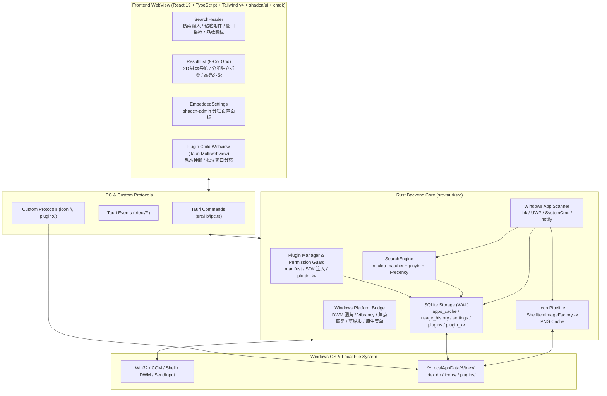
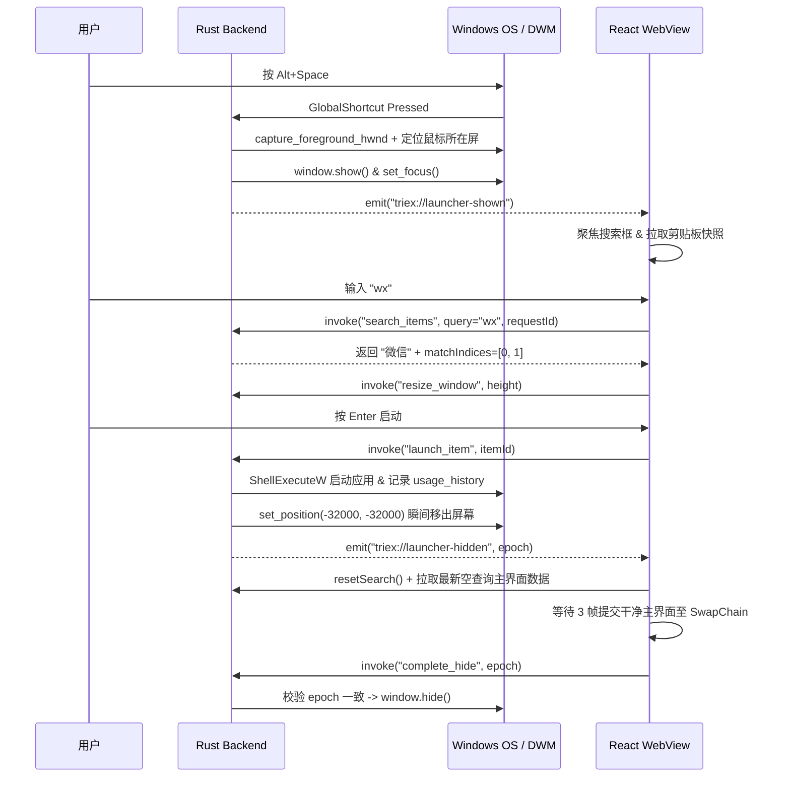
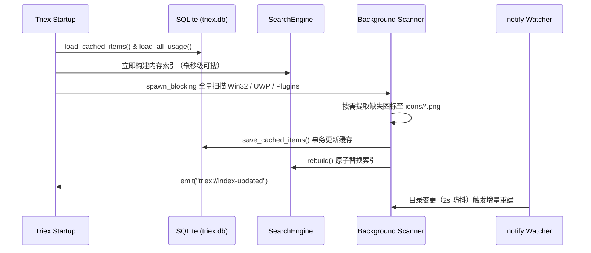

# Triex 系统架构文档

> 本文档描述 **Triex**（基于 Tauri v2 + Rust + React 的 Windows 应用启动器与插件平台）的整体架构、核心子系统设计、关键数据流、IPC 契约与安全边界。  
> 关于各项技术选型背后的权衡理由，请参阅 [架构与实现取舍记录 (ADR)](./architecture-decisions.md)。

---

## 1. 概述与设计目标

**Triex** 是一款面向 Windows 10/11 的轻量级、键盘优先桌面应用启动器与插件宿主：

* **极致轻量与低延迟**：后端采用纯 Rust 实现内存模糊检索与 Windows 原生集成，无 Node.js 常驻进程；冷启动直接加载 SQLite 缓存立即可搜。
* **ZTools 风格主界面**：`800px` 宽无边框原生圆角窗体（Windows 11 DWM + Mica/Acrylic），顶部大字号无框搜索栏 + 右上角品牌圆标，下方为 9 列图标卡片网格与 2D 方向键导航。
* **`shadcn-admin` 风格内嵌设置**：基于官方 shadcn/ui（New York）组件构建的主窗口内嵌设置面板，无需额外弹出孤立设置窗口。
* **安全可扩展插件宿主**：基于 Tauri v2 Multiwebview、自定义 `plugin://` 协议与最小权限沙箱隔离承载本地 Web 插件。

---

## 2. 总体分层架构



---

## 3. 代码目录与职责映射

```text
triex/
├── docs/                                # 架构与设计文档
│   ├── architecture.md                  # 本文档：整体系统架构
│   └── architecture-decisions.md        # 关键技术取舍记录 (ADR)
├── index.html                           # 主启动器窗口入口
├── settings.html                        # 独立设置入口（保留兼容）
├── src/                                 # 前端 React 应用
│   ├── App.tsx                          # 启动器根装配（TooltipProvider + Command + 视图切换）
│   ├── index.css                        # Tailwind v4、shadcn CSS 变量与 overflow: clip 根防漂移规则
│   ├── components/
│   │   ├── ui/                          # 官方 shadcn/ui 标准组件（15 个）
│   │   └── launcher/                    # 启动器业务组件
│   │       ├── SearchHeader.tsx         # 顶部搜索框、粘贴附件胶囊、窗口拖拽、品牌圆标
│   │       ├── ResultList.tsx           # 9 列网格、分组独立展开/收起、2D 方向键导航
│   │       ├── ResultItem.tsx           # 图标卡片与彩色系统兜底图标
│   │       ├── HighlightText.tsx        # 根据 Rust matchIndices 高亮中文/拼音命中字符
│   │       └── EmbeddedSettings.tsx     # shadcn-admin 风格内嵌设置面板
│   ├── hooks/
│   │   ├── useSearch.ts                 # 防竞态 (requestId) + 16ms 微防抖搜索
│   │   ├── useWindowAutoResize.ts       # rAF 合并高度测量与内嵌设置固定高度同步
│   │   ├── useLauncherShortcuts.ts      # Esc 分层退出、Ctrl+M/Ctrl+K、离屏预重置握手
│   │   └── useThemeSync.ts              # 系统深浅色与配置主题联动
│   ├── stores/                          # Zustand 状态管理
│   │   ├── useLauncherStore.ts          # 搜索态、置顶项、分组展开态、设置/插件切换态
│   │   └── useSettingsStore.ts          # 持久化配置与插件列表状态
│   └── lib/
│       ├── ipc.ts                       # 强类型 Tauri IPC 封装层
│       ├── protocol.ts                  # http://icon.localhost/{key}.png 地址构造
│       └── utils.ts                     # cn() 样式合并工具
└── src-tauri/                           # Rust 后端 (triex_lib)
    ├── tauri.conf.json                  # 无边框透明主窗体 (800x64) 与打包配置
    ├── capabilities/
    │   ├── default.json                 # 主窗体核心能力权限
    │   └── plugin-webview.json          # 插件子 Webview 最小沙箱权限
    ├── resources/
    │   └── plugin-bridge.js             # 注入插件 Webview 的 window.triex SDK
    └── src/
        ├── lib.rs                       # 应用初始化、State 管理、协议/托盘/热键/事件装配
        ├── state.rs                     # 全局线程安全 AppState
        ├── config.rs                    # AppSettings 与 %LocalAppData%\triex 路径管理
        ├── error.rs                     # 统一 AppError (thiserror)
        ├── tray.rs                      # 系统托盘菜单与左键切换
        ├── commands/                    # Tauri IPC Commands (search / launcher / clipboard / plugin / settings)
        ├── search/                      # 内存搜索引擎 (nucleo-matcher / pinyin_index / matcher / frecency)
        ├── platform/                    # Windows 原生封装 (scanner / icon / launch / window / clipboard / input)
        ├── plugins/                     # 插件宿主 (manifest / manager / permission)
        ├── protocol/                    # 自定义协议 (icon:// 与 plugin://)
        └── storage/                     # SQLite WAL 持久化与迁移脚本 (001_init.sql)
```

---

## 4. 核心子系统设计

### 4.1 搜索引擎（`src-tauri/src/search/`）

搜索引擎常驻内存，由 `Mutex<SearchEngine>` 保护，单次查询耗时通常 `< 1ms`：

1. **拼音与首字母预计算（`pinyin_index.rs`）**：
   * 索引构建期将每个条目的 `name` 投影为：
     * `full`（全拼 + 小写字母数字）与 `full_char_map`（每个拼音字符对应原文字符下标）
     * `abbr`（汉字拼音首字母 + 英文单词/驼峰首字母）与 `abbr_char_map`
   * 查询命中拼音时，通过映射表将 `nucleo-matcher` 返回的下标反查回原中文字符下标，前端直接高亮对应汉字（例如输入 `wx` 高亮“微信”两字）。
2. **多通道加权打分（`matcher.rs`）**：
   * 复用同一个 `nucleo_matcher::Matcher` 实例避免重复分配内存。
   * 通道权重：`name (1.00)` > `pinyin_abbr (0.92)` > `pinyin_full (0.86)` > `keywords (0.80)`，叠加完全匹配加分（`+120`）、前缀加分（`+60`）与 `frecency`。
3. **Frecency 排序（`frecency.rs`）**：
   * 使用 7 天指数半衰期衰减公式结合 `ln(1 + launch_count)`，让高频且近期使用的应用自然浮出顶部；空查询时优先保证 `pinned_items` 与 `frecency > 0` 的真实历史记录不被截断。

### 4.2 Windows 原生平台层（`src-tauri/src/platform/`）

| 模块 | 依赖 Windows API / Crate | 职责说明 |
| :--- | :--- | :--- |
| `scanner/win32.rs` | `IShellLinkW`, `IPersistFile`, `walkdir` | 递归扫描公共/用户开始菜单及自定义目录 `.lnk`/`.exe`，自动过滤卸载/帮助等噪音项 |
| `scanner/uwp.rs` | `SHGetKnownFolderItem(FOLDERID_AppsFolder)`, `IShellItem2` | 枚举现代 UWP/MSIX 应用与 `AppUserModelId (AUMID)` |
| `scanner/system_cmd.rs` | 内置静态注册表 | 提供锁屏、睡眠、重启、关机、任务管理器、环境变量等 12 项高频系统指令 |
| `scanner/watcher.rs` | `notify::RecommendedWatcher` | 监听开始菜单变更，2 秒防抖后后台增量重建索引 |
| `icon.rs` | `IShellItemImageFactory`, `GetDIBits`, `image` | 统一提取 Win32 与 `shell:AppsFolder\<AUMID>` 的 64×64 RGBA 图标并转存为 PNG |
| `launch.rs` | `ShellExecuteW`, `IApplicationActivationManager` | 支持普通打开、提权管理员运行 (`runas`)、打开所在位置、UWP 激活与电源控制 |
| `window.rs` | `DwmSetWindowAttribute`, `window-vibrancy`, `GetCursorPos`, `MonitorFromPoint` | 强制 Win11 DWM 原生圆角 (`DWMWCP_ROUND`)、Mica/Acrylic、多屏鼠标跟随定位、前窗 HWND 焦点恢复、锁死左上角坐标防 DPI 漂移 |
| `clipboard.rs` / `input.rs` | `OpenClipboard`, `GetClipboardData`, `SetClipboardData`, `SendInput` | 剪贴板文本/URL/JSON 识别、原生剪贴板写入与模拟 `Ctrl+V` |

### 4.3 Multiwebview 插件宿主（`src-tauri/src/plugins/`）

* **资源隔离**：本地插件存放于 `%LocalAppData%\triex\plugins\<plugin-id>\`，包含 `plugin.json`（声明 `id`、`entry`、`height`、`features`、`permissions`），通过自定义 `plugin://<plugin-id>/<path>` 协议加载并严格执行 `canonicalize()` 路径穿越校验。
* **视图生命周期**：通过 Tauri v2 `WebviewBuilder::new` 挂载为 `main` 窗口的子 Webview（位于顶部 `64px` 搜索栏下方），支持：
  * 顶部搜索栏自动切换为插件 `SubInput` 并将输入通过 `eval` 派发 `triex:sub-input-change` 事件；
  * 一键分离为独立 OS 窗口（`detach_active_plugin`）。
* **SDK 注入与权限守卫**：通过 `initialization_script` 注入 [plugin-bridge.js](file:///d:/WorkSpace/triex/src-tauri/resources/plugin-bridge.js) 暴露 `window.triex`；后端按调用方 Webview label（`plugin-<id>`）核对 `manifest.permissions` 后才允许读写该插件专属的 `plugin_kv` 命名空间。

### 4.4 本地数据存储（`src-tauri/src/storage/`）

所有持久化数据收敛在 `%LocalAppData%\triex\triex.db`（SQLite WAL 模式，`busy_timeout = 5000ms`）：

| 表名 | 主键 | 用途 |
| :--- | :--- | :--- |
| `apps_cache` | `id` | 缓存扫描得到的应用/UWP/系统指令元数据，用于冷启动瞬间恢复搜索索引 |
| `usage_history` | `item_id` | 记录启动次数 (`launch_count`) 与最近时间戳 (`last_used_at`) 驱动 Frecency |
| `settings` | `key` | 持久化 `AppSettings` JSON（快捷键、主题、材质、自定义目录、屏蔽与置顶列表） |
| `plugins` | `id` | 已安装插件元数据、启用状态与完整 `manifest_json` |
| `plugin_kv` | `(plugin_id, key)` | 按 `plugin_id` 隔离的插件 KV 存储（含版本号 `rev` 与更新时间） |

### 4.5 前端状态与交互架构（`src/`）

* **单向数据流**：`useLauncherStore` 管理高频交互态（搜索词、结果、选中项、置顶、分组独立展开 `expandedSections`、内嵌设置/插件模式）；`useSettingsStore` 管理配置表单与插件启停。
* **防闪烁与防漂移机制**：
  * 根容器采用 `overflow: clip`（替代 `overflow: hidden`），从浏览器引擎层彻底禁止 `cmdk` 内部 `scrollIntoView` 滚动外层页面。
  * 半透明背景提升至单层 `html:has(body.launcher-body)`，窗口缩放过渡帧不露底色。
  * `useWindowAutoResize` 用 `requestAnimationFrame` 合并同帧高度测量；进入内嵌设置页时锁定高度为 `580px`。
* **2D 网格键盘导航**：`ResultList` 按 9 列构建跨分组视觉坐标矩阵 `(row, col)`，在捕获阶段接管 `← / → / ↑ / ↓` 与 `Enter`，仅在内部 `CommandList` 容器内调整 `scrollTop`。

---

## 5. 关键链路时序

### 5.1 呼出 → 搜索 → 启动 → 离屏预重置隐藏

为解决 Windows WebView2 在 `window.hide()` 后暂停合成新帧导致下次呼出闪现旧搜索界面的问题，隐藏采用**离屏预重置帧缓冲**机制：



### 5.2 应用冷启动与索引热更新



---

## 6. 前后端 IPC 契约总览

### 6.1 Tauri Commands（前端 → Rust）

| 分组 | Command | 说明 |
| :--- | :--- | :--- |
| **搜索与索引** | `search_items(query, requestId, limit?)` | 执行 `nucleo-matcher` + `pinyin` 搜索并返回高亮下标 |
| | `rebuild_index()` | 触发全量异步应用/UWP/插件扫描并刷新图标缓存 |
| **启动与窗口** | `launch_item(itemId, asAdmin?)` | 启动 Win32/UWP/系统指令，或挂载插件/打开内嵌设置 |
| | `open_item_folder(itemId)` | 在资源管理器中定位目标文件 |
| | `toggle_pin_item(itemId)` / `remove_recent_item(itemId)` | 固定/取消固定常用项；清除单条使用记录 |
| | `show_item_context_menu(itemId)` / `show_brand_context_menu()` | 弹出原生 Windows 上下文菜单（带防失焦隐藏保护） |
| | `set_settings_view_open(open)` | 同步内嵌设置视图状态至后端以保护失焦不关闭 |
| | `resize_window(height)` / `hide_window()` / `complete_hide(epoch)` | 窗口高度同步与离屏预重置隐藏握手 |
| **剪贴板** | `get_clipboard_snapshot()` / `paste_to_previous_window()` | 读取剪贴板文本摘要 / 归还焦点并模拟 `Ctrl+V` |
| **插件宿主** | `list_plugins()` / `set_plugin_enabled(pluginId, enabled)` | 插件列表查询与启停 |
| | `open_plugin_command` / `close_plugin_command` / `detach_plugin_command` | Multiwebview 挂载、关闭与独立窗口分离 |
| | `set_plugin_sub_input` / `forward_sub_input_value` | 插件子输入框占位符同步与输入转发 |
| | `plugin_db_get` / `plugin_db_put` / `plugin_db_delete` | 受权限校验的插件命名空间 KV 读写 |
| **设置** | `get_settings()` / `update_settings(newSettings)` / `open_settings()` | 读取/保存配置（联动热键、自启、材质、重扫）与唤起设置视图 |

### 6.2 Tauri Events（Rust → 前端）

| 事件名 | Payload | 触发时机 |
| :--- | :--- | :--- |
| `triex://launcher-shown` | `()` | 主窗口被快捷键、托盘或单实例唤醒显示时 |
| `triex://launcher-hidden` | `epoch: number` | 窗口移至屏幕外触发前端预重置主界面帧时 |
| `triex://index-updated` | `IndexStatus` | 后台全量扫描或目录监控重建索引完成时 |
| `triex://settings-updated` | `AppSettings` | 用户更新设置或切换固定项后同步全局状态 |
| `triex://open-settings` / `triex://toggle-settings` | `()` | 托盘、菜单或指令要求打开/切换内嵌设置面板 |
| `triex://toggle-dashboard` | `()` | 菜单触发切换完整工作台展开状态 |
| `triex://plugin-opened` / `triex://plugin-closed` | `ActivePluginSession` / `string` | 插件子 Webview 挂载或关闭时 |
| `triex://sub-input-placeholder` | `string` | 插件动态更新顶部子输入框提示文案时 |
| `triex://status-message` | `string` | 原生菜单动作执行后的轻量状态反馈提示 |

---

## 7. 安全与权限边界

1. **Tauri Capabilities 最小化拆分**：
   * [default.json](file:///d:/WorkSpace/triex/src-tauri/capabilities/default.json) 仅向 `main` 窗口开放窗口尺寸、位置、拖拽、快捷键与自启能力。
   * [plugin-webview.json](file:///d:/WorkSpace/triex/src-tauri/capabilities/plugin-webview.json) 仅向 `plugin-*` 子 Webview 授予基础事件能力，所有系统能力必须经由 Rust Command 按 `plugin.json` 权限表二次鉴权。
2. **自定义协议路径防护**：
   * `icon://` 协议严格校验 `icon_key` 必须为 1~64 位纯十六进制哈希字符。
   * `plugin://` 协议严格校验 `plugin_id` 为 `[a-zA-Z0-9_-]`，并通过 `AppPaths::ensure_within_dir`（规范化路径前缀比对）彻底阻止 `../` 路径穿越读取宿主机文件。
3. **单实例与并发安全**：
   * 通过 `tauri-plugin-single-instance` 防止重复启动；跨线程状态统一通过 `Mutex`、`RwLock` 与 `Atomic*` 原语保护，生产路径避免 `unwrap()`/`expect()` 触发 panic。
