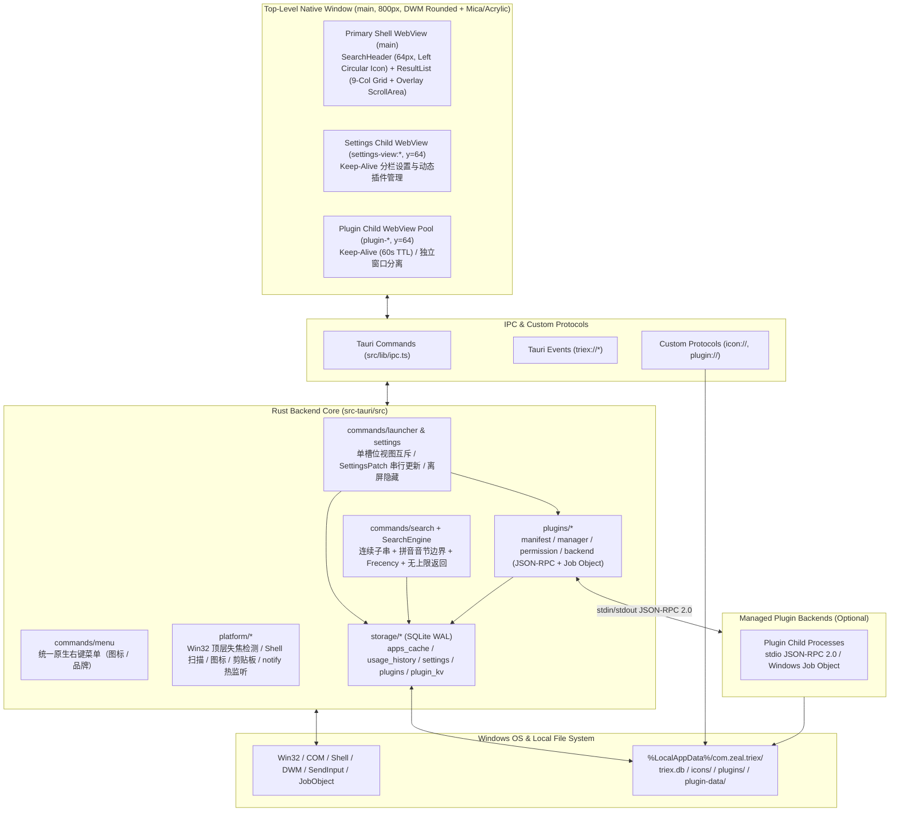
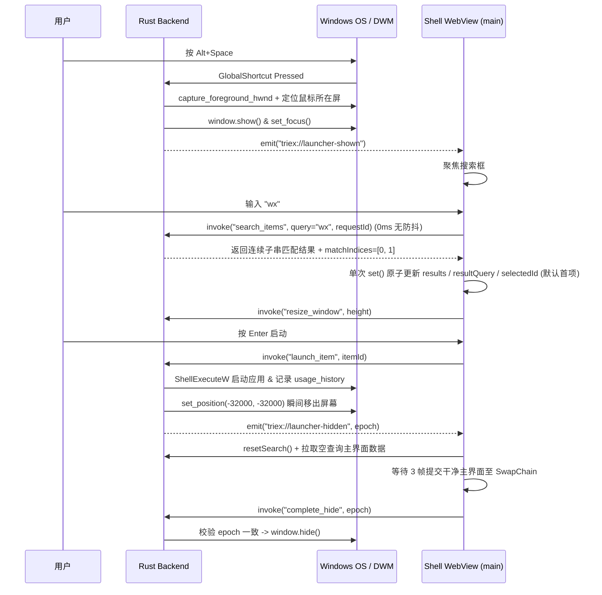
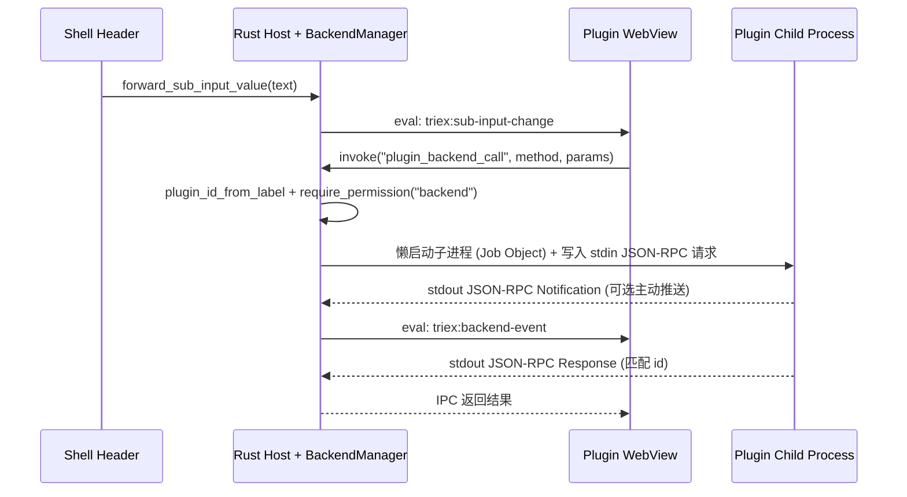

# Triex 系统架构文档

> 本文档描述 **Triex**（基于 Tauri v2 + Rust + React 的 Windows 应用启动器与动态插件平台）的整体架构、核心子系统设计、关键数据流、IPC 契约与安全边界。
> 关于各项技术选型背后的权衡理由，请参阅 [架构与实现取舍记录 (ADR)](./architecture-decisions.md)。

---

## 1. 概述与设计目标

**Triex** 是一款面向 Windows 10/11 的轻量级、键盘优先桌面应用启动器与动态插件宿主：

* **极致轻量与低延迟**：后端采用纯 Rust 实现内存连续子串与拼音检索及 Windows 原生集成，无 Node.js 常驻进程；冷启动直接加载 SQLite 缓存立即可搜，图标缓存提取与索引发布异步解耦。
* **ZTools / Rubick 风格主界面与多 WebView 宿主**：`800px` 宽无边框原生圆角纯容器窗体（Windows 11 DWM + Mica/Acrylic），由顶栏/搜索主壳 WebView（`main`）与下方物理零重叠的保活子 WebView（`settings-view:*` 或 `plugin-*`）组成；顶栏最左侧固定圆形主图标/插件图标，加载子视图时外围显示旋转加载环。
* **统一毛玻璃设计系统**：主壳与设置子 WebView 共享 `shadcn/ui` 语义 Token、半透明表面层级（`--surface*`）与统一 Radix `ScrollArea` 悬浮滚动条（零布局占位）；全应用统一使用 Tauri v2 原生上下文菜单并全局屏蔽浏览器默认菜单。
* **动态插件系统与严格权限边界**：支持纯 Webview 插件与「Webview + 独立子进程后端（JSON-RPC 2.0 over stdio）」混合插件的热安装、卸载、目录监听热加载与空闲回收；通过 `require_host_webview`、`plugin_id_from_label` 与 `require_permission` 严格隔离宿主特权命令与第三方插件沙箱能力。

---

## 2. 总体分层架构



---

## 3. 代码目录与职责映射

```text
triex/
├── docs/                                # 架构与设计文档
│   ├── architecture.md                  # 本文档：整体系统架构
│   └── architecture-decisions.md        # 关键技术取舍记录 (ADR)
├── plugins/calculator/                  # 示例插件：Webview + 独立子进程科学计算器
├── index.html                           # 主启动器壳 WebView 入口
├── settings.html                        # 设置子 WebView 独立入口
├── src/                                 # 前端 React 应用（Vite 双入口）
│   ├── main.tsx / App.tsx               # 主启动器壳装配（纯 React 布局，无 cmdk 包装层）
│   ├── settings-main.tsx / SettingsApp.tsx # 设置子 WebView 装配与分栏导航
│   ├── index.css                        # Tailwind v4、毛玻璃表面 Token 与防漂移规则
│   ├── components/
│   │   ├── ui/                          # 精简保留的 shadcn/ui 基础组件（含扩展后的 ScrollArea）
│   │   ├── launcher/                    # 主壳组件（SearchHeader / ResultList / ResultItem / HighlightText）
│   │   └── settings/                    # 模块化设置页（General / Appearance / Index / PluginManager / Command / About / SettingsPrimitives）
│   ├── hooks/
│   │   ├── useSearch.ts                 # 0ms 即时搜索 + 防竞态 (requestId) + 选中焦点策略
│   │   ├── useWindowAutoResize.ts       # 搜索态 rAF 高度测量与同步
│   │   ├── useLauncherShortcuts.ts      # Esc 分层退出、Ctrl+M、Ctrl+K、Alt+Enter
│   │   ├── useLauncherEvents.ts         # 窗口显隐握手、子视图加载态 (view-loaded) 与全局提示监听
│   │   ├── useNativeContextMenu.ts      # 全局屏蔽浏览器默认菜单
│   │   └── useThemeSync.ts              # 系统深浅色与配置主题联动
│   ├── stores/
│   │   ├── useLauncherStore.ts          # 主壳专属状态（含 resultQuery 原子提交与 viewLoading）
│   │   └── useSettingsStore.ts          # 设置子 WebView 专属状态、串行保存与插件热管理
│   └── lib/
│       ├── ipc.ts                       # 强类型 Tauri IPC 封装层
│       ├── protocol.ts                  # icon:// 与 plugin:// 自定义协议 URL 构造
│       └── utils.ts                     # cn() 样式合并工具
└── src-tauri/                           # Rust 后端 (triex_lib)
    ├── tauri.conf.json                  # 应用元数据与打包配置（纯动态建窗）
    ├── capabilities/
    │   ├── default.json                 # 主壳与设置子 WebView 宿主权限
    │   ├── plugin-webview.json          # 插件子 WebView 最小化沙箱权限
    │   └── plugins.json                 # 第三方插件 WebView 受限 IPC 通道
    ├── resources/
    │   └── plugin-bridge.js             # 注入插件 WebView 的 window.triex SDK
    └── src/
        ├── lib.rs                       # 纯父窗口初始化、协议注册、命令注册与顶层窗口事件监听
        ├── state.rs                     # 统一 ContentMode 状态机、PluginBackendManager 与线程安全 AppState
        ├── config.rs                    # AppSettings、SettingsPatch 与本地数据路径（含 plugin-data/）
        ├── error.rs                     # 统一 AppError (thiserror)
        ├── tray.rs                      # 系统托盘菜单与左键切换
        ├── commands/                    # Tauri IPC Commands (launcher / menu / search / settings / plugin / clipboard / updater)
        ├── search/                      # 内存连续子串搜索引擎 (pinyin_index / index / matcher / frecency)
        ├── platform/                    # Windows 原生封装 (scanner / icon / launch / window / clipboard / input)
        ├── plugins/                     # 动态插件宿主 (mod / manifest / manager / backend / permission)
        ├── protocol/                    # 自定义协议 (icon:// 与 plugin://)
        └── storage/                     # SQLite WAL 持久化与迁移脚本 (001_init.sql)
```

---

## 4. 核心子系统设计

### 4.1 连续子串搜索引擎与非阻塞索引协调（`search/` + `commands/search.rs`）

1. **拼音与音节边界预计算（`pinyin_index.rs` + `index.rs`）**：
   * 构建期预生成全拼（`full`）、首字母/英文词边界缩写（`abbr`）、去空白小写名称（`name_compact`）及各自的原字符下标映射表。
   * 为全拼额外记录 `full_is_start` / `full_is_end` 音节边界标记，防止跨音节误命中（如 `eix` 不会命中 `weixin`），同时支持半音节惩罚。
2. **四路连续子串打分与无上限返回（`matcher.rs` / `frecency.rs`）**：
   * 依次匹配 `name_lower`、`name_compact`、`pinyin.abbr`、`pinyin.full`（对齐音节起点）与 `keywords_lower`，取最高分通道。
   * 统一分层评分：`exact (1050)` > `prefix (1000)` ≫ `contains (100)`，结合通道偏移、半音节罚分（`-30`）、去空白罚分（`-10`）、命中位置罚分（`-2/字符`）、名称字符数罚分（`-1/字符`），并叠加 7 天半衰期 Frecency。
   * 次级排序按字符数（`chars().count()`）与小写字典序升序；默认**不限制返回个数**，前端网格默认折叠展示 2 行（18 项），点击「展开全部」可浏览全部命中结果。
   * UWP 应用仅以显示名称与拼音参与检索（不注入内部 AUMID 包名关键词），避免 `ZuneMusic` 等历史包名干扰搜索。
3. **重扫合并、热监听与异步图标预热（`commands/search.rs`）**：
   * 通过 `index_requested` 代数合并并发重扫请求，扫描完成后立即原子替换内存索引并通知前端可搜，随后在后台线程调用 `warm_missing_icons` 异步补齐缺失的 PNG 图标缓存。
   * `notify` 目录监听器同时监听开始菜单目录、用户自定义目录与 `%LocalAppData%\triex\plugins\`，实现应用与插件的热更新。

### 4.2 物理零重叠多 WebView、加载态同步与保活池（`commands/settings.rs` + `plugins/manager.rs`）

* **纯容器窗口 + 上下分区**：`main` 顶层窗口由 `WindowBuilder` 创建。搜索态下主壳 WebView `main` 占满窗口 `800 × h`；进入设置或插件态时，主壳 WebView 收缩至仅占顶栏 `800 × 64`，子 WebView 挂载于 `y = 64` 下方，两个 WebView2 HWND **物理零重叠**。
* **单槽位互斥（`ContentMode`）**：`AppState.content_mode` 统一维护 `Search | Settings | Plugin(session)`，打开设置自动隐藏插件，打开插件自动隐藏设置。
* **真实加载态反馈**：新建设置或插件子 WebView 时，挂载 `WebviewBuilder::on_page_load`，在 `PageLoadEvent::Finished` 时派发 `triex://view-loaded`（并对新插件补发首次 `triex:plugin-enter`），驱动顶栏最左侧圆形图标的外围旋转加载环准确起停。
* **保活复用与空闲回收**：
  * 设置子 WebView（`settings-view:*`）首次按需创建，退出时仅 `hide()` 保活，二次打开 `< 5ms` 且无需转圈。
  * 插件子 WebView（`plugin-<id>:<seq>`）退出时 `hide()` 保活 60 秒，期间重开零延迟复用并派发 `triex:plugin-enter`；超时、禁用、卸载或分离为独立窗口时自动 `close()` 释放内存。
* **Win32 顶层窗口级失焦检测**：通过 `GetForegroundWindow()` + `GetAncestor(..., GA_ROOT)` 配合 `35ms` 防抖，确保焦点在顶栏与子 WebView 间切换绝不误隐藏，切出 Triex 外部时准确隐藏。

### 4.3 动态插件系统与独立子进程后端（`plugins/` + `plugin-bridge.js`）

Triex 采用务实的**两档动态插件架构**：

1. **纯 Webview 插件**：由 `plugin.json` + 静态前端资源 + `logo` 组成，通过 `plugin://` 协议加载，前端 JS 直接通过 `window.triex.*` 调用宿主受控能力（`db`、`clipboard`、`process.exec`、`setHeight`、`setSubInput`）。
2. **Webview + 独立子进程后端混合插件（`backend.rs`）**：
   * 插件在 `plugin.json` 中声明 `backend: { kind: "process", entry, args, idleTimeoutSecs }` 与 `"backend"` 权限。
   * **按需懒启动与隔离**：首次收到 `plugin_backend_call` 时拉起子进程，注入 `TRIEX_PLUGIN_ID`、`TRIEX_PLUGIN_DIR`、`TRIEX_PLUGIN_DATA_DIR`（独立数据目录 `%LocalAppData%\triex\plugin-data\<id>`），Windows 下附带 `CREATE_NO_WINDOW` 隐藏控制台窗口。
   * **JSON-RPC 2.0 over stdio 桥接**：前端调用 `window.triex.backend.call(method, params)` → Rust 校验调用方标签与权限 → 写入子进程 `stdin` 并挂起 `oneshot` 等待同 `id` 响应；子进程输出无 `id` 的 JSON-RPC Notification 时，Rust 自动通过 `triex:backend-event` 转发至对应插件 Webview。
   * **防僵尸进程与空闲回收**：Windows 下通过 **Job Object（`JOB_OBJECT_LIMIT_KILL_ON_JOB_CLOSE`）** 托管所有插件子进程，确保宿主异常退出时由系统自动清理；插件关闭后按 `idleTimeoutSecs` 定时发送 `shutdown` 通知并回收，禁用或卸载时立即强停进程再删文件。

### 4.4 本地数据存储（`src-tauri/src/storage/`）

所有持久化数据收敛在本地数据目录 `triex.db`（SQLite WAL 模式，`busy_timeout = 5000ms`）：

| 表名 | 主键 | 用途 |
| :--- | :--- | :--- |
| `apps_cache` | `id` | 缓存扫描得到的应用/UWP/系统指令元数据，用于冷启动瞬间恢复搜索索引 |
| `usage_history` | `item_id` | 记录启动次数 (`launch_count`) 与最近时间戳 (`last_used_at`) 驱动 Frecency |
| `settings` | `key` | 持久化 `AppSettings` JSON（快捷键、主题、材质、自定义目录、屏蔽与置顶列表） |
| `plugins` | `id` | 已安装插件元数据、启用状态与完整 `manifest_json` |
| `plugin_kv` | `(plugin_id, key)` | 按 `plugin_id` 隔离的插件 KV 存储（含版本号 `rev` 与更新时间） |

---

## 5. 关键链路时序

### 5.1 呼出 → 即时搜索 → 启动 → 离屏预重置隐藏



### 5.2 混合插件前后端通信（Webview + 独立子进程）



---

## 6. 前后端 IPC 契约总览

### 6.1 Tauri Commands（前端 → Rust）

| 分组 | Command | 调用方权限 | 说明 |
| :--- | :--- | :--- | :--- |
| **搜索与索引** | `search_items(query, requestId, limit?)` | 仅宿主 (`main` / `settings-view:*`) | 执行连续子串 + 拼音音节边界匹配并返回高亮下标（默认不限制个数） |
| | `rebuild_index()` | 仅宿主 | 触发全量异步应用/UWP/插件重扫与后台图标预热 |
| **启动与窗口** | `launch_item(itemId, asAdmin?)` | 仅宿主 | 启动应用/系统指令，或挂载插件子视图 |
| | `open_item_folder(itemId)` | 仅宿主 | 在资源管理器中定位目标文件 |
| | `toggle_pin_item(itemId)` / `remove_recent_item(itemId)` | 仅宿主 | 固定/取消固定常用项；清除单条使用记录 |
| | `show_item_context_menu` / `show_brand_context_menu` | 仅宿主 | 弹出图标或品牌按钮原生上下文菜单 |
| | `resize_window(height)` / `complete_hide(epoch)` | 仅宿主 | 搜索态窗口高度同步与离屏隐藏完成握手 |
| | `hide_window()` | 宿主与插件 | 隐藏主启动器窗口 |
| **剪贴板** | `get_clipboard_snapshot()` | 宿主与插件 | 读取当前剪贴板文本摘要 |
| | `read_clipboard_text()` / `paste_to_previous_window()` | 仅宿主 | 读取剪贴板文本；隐藏启动器、归还焦点并模拟 `Ctrl+V` |
| **插件宿主管理** | `list_plugins()` / `reload_plugins()` / `open_plugins_dir()` | 仅宿主 | 查询插件列表、重新扫描插件目录、打开本地插件文件夹 |
| | `install_plugin_dir(sourceDir)` / `uninstall_plugin(pluginId)` | 仅宿主 | 热导入本地插件目录；安全停止后端/驱逐缓存并卸载插件 |
| | `set_plugin_enabled(pluginId, enabled)` | 仅宿主 | 启停插件（禁用时立即驱逐保活 WebView 并停止后端进程） |
| | `open_plugin_command` / `close_plugin_command` / `detach_plugin_command` | 仅宿主 | 插件子 WebView 挂载、保活隐藏与独立窗口分离 |
| | `forward_sub_input_value(value)` / `forward_sub_input_keydown(key, shiftKey)` | 仅宿主 | 将顶栏子输入框内容与按键事件转发至当前活动插件 |
| **插件沙箱 SDK** | `set_plugin_sub_input(placeholder)` / `plugin_set_height(height)` | 仅活动插件 | 更新顶栏子输入框占位符或动态调整嵌入视图高度（`240~720px`） |
| | `plugin_backend_call(method, params?, timeoutMs?)` | 仅声明 `backend` 权限的插件 | 通过 JSON-RPC 2.0 over stdio 调用该插件专属独立后端进程 |
| | `plugin_exec_command(command, args?, timeoutMs?)` | 仅声明 `process` 权限的插件 | 隐藏窗口执行单次外部命令（带超时保护，适合外挂 CLI 工具） |
| | `plugin_db_get` / `plugin_db_put` / `plugin_db_delete` | 仅声明 `db` 权限的插件 | 按调用方 WebView 标签隔离读写 `plugin_kv` |
| **设置与更新** | `get_settings()` / `update_settings(patch)` | 仅宿主 | 读取配置或串行应用 `SettingsPatch` 增量更新 |
| | `open_settings()` / `close_settings()` / `toggle_settings()` | 仅宿主 | 打开、保活隐藏或切换设置子 WebView |
| | `check_update()` / `get_cached_update()` / `install_update()` / `open_data_dir()` | 仅宿主 | 在线更新检测、安装与打开本地数据目录 |

### 6.2 Tauri Events（Rust → 前端）

| 事件名 | Payload | 触发时机 |
| :--- | :--- | :--- |
| `triex://launcher-shown` | `()` | 主窗口被快捷键、托盘或单实例唤醒显示时 |
| `triex://launcher-hidden` | `epoch: number` | 窗口移至屏幕外触发前端预重置搜索框或快速完成隐藏时 |
| `triex://index-updated` | `IndexStatus` | 索引交换完成或后台新图标提取完成时 |
| `triex://settings-updated` | `AppSettings` | 配置或固定列表更新后广播至主壳与设置子 WebView |
| `triex://settings-opened` / `triex://settings-closed` | `loading: boolean` / `()` | 设置子 WebView 显示（含是否首次加载）或隐藏时同步主壳顶栏状态 |
| `triex://plugin-opened` / `triex://plugin-closed` | `ActivePluginSession` / `string` | 插件子 WebView 挂载/复用（含 `logo` 与 `loading`）或隐藏时 |
| `triex://view-loaded` | `"settings" \| pluginId` | 新建子 WebView 触发 `PageLoadEvent::Finished` 时停止顶栏外围加载环 |
| `triex://toggle-dashboard` | `()` | 原生菜单触发切换完整应用工作台 |
| `triex://sub-input-placeholder` | `string` | 插件动态更新顶部子输入框提示文案时 |
| `triex://status-message` | `string` | 顶栏轻量状态反馈胶囊提示 |
| `triex://update-available` | `UpdateMetadata` | 检测到新版本可供更新时 |

---

## 7. 安全与权限边界

1. **宿主与插件 IPC 严格分权**：
   * [default.json](file:///d:/WorkSpace/triex/src-tauri/capabilities/default.json) 向 `main` 与 `settings-view:*` 授予宿主窗口控制能力；[plugin-webview.json](file:///d:/WorkSpace/triex/src-tauri/capabilities/plugin-webview.json) 与 [plugins.json](file:///d:/WorkSpace/triex/src-tauri/capabilities/plugins.json) 仅开放插件最小化沙箱权限。
   * 所有宿主管理类 Command 均在入口处调用 `require_host_webview(&webview)` 强校验调用方标签，阻止第三方插件越权调用 `launch_item`、`update_settings`、`install_plugin_dir`、`set_plugin_enabled` 等特权接口。
   * 所有插件沙箱接口（`db`、`backend`、`process`）均通过 `plugin_id_from_label` + `require_permission` 强绑定插件自身命名空间与 `plugin.json` 权限声明，杜绝跨插件调用。
2. **自定义协议与后端路径防护**：
   * `icon://` 严格校验 1~64 位十六进制哈希键名。
   * `plugin://`（Windows 下映射为 `http://plugin.localhost/<id>/<path>`）与 `backend.entry` 均严格校验 `plugin_id` 字符集并通过 `AppPaths::ensure_within_dir` 规范化路径比对阻止目录穿越。
3. **子进程资源隔离与清理**：
   * 插件后端子进程不监听公网/本地 TCP 端口，仅通过宿主管道通信；Windows 上全部纳入 `JOB_OBJECT_LIMIT_KILL_ON_JOB_CLOSE` Job Object，确保无僵尸进程残留。
